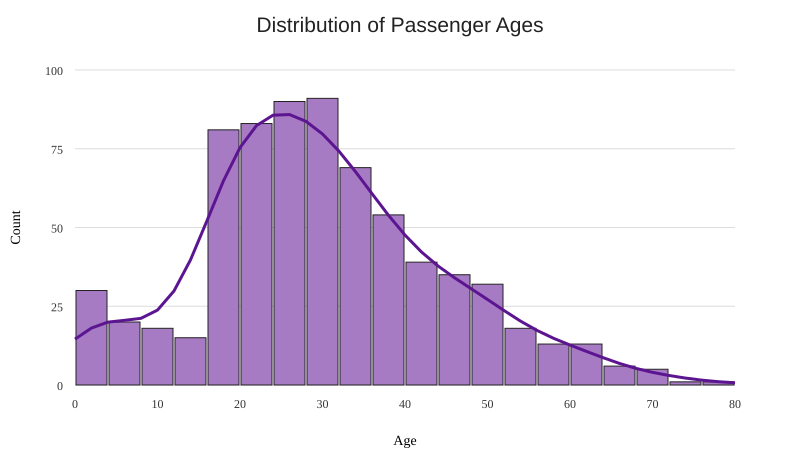
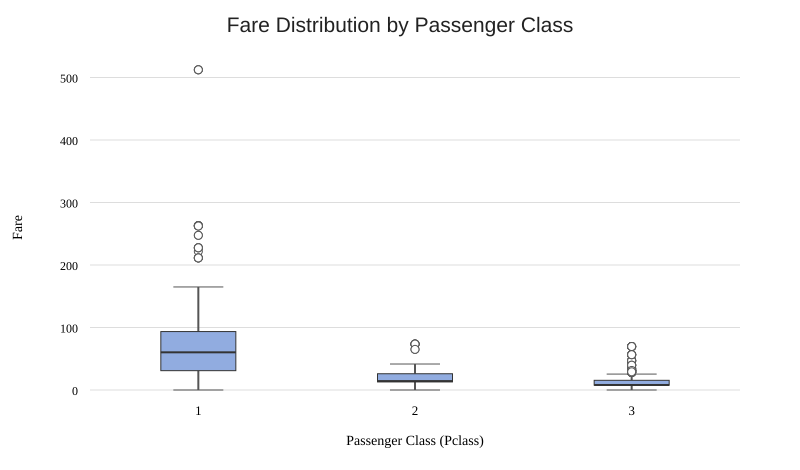
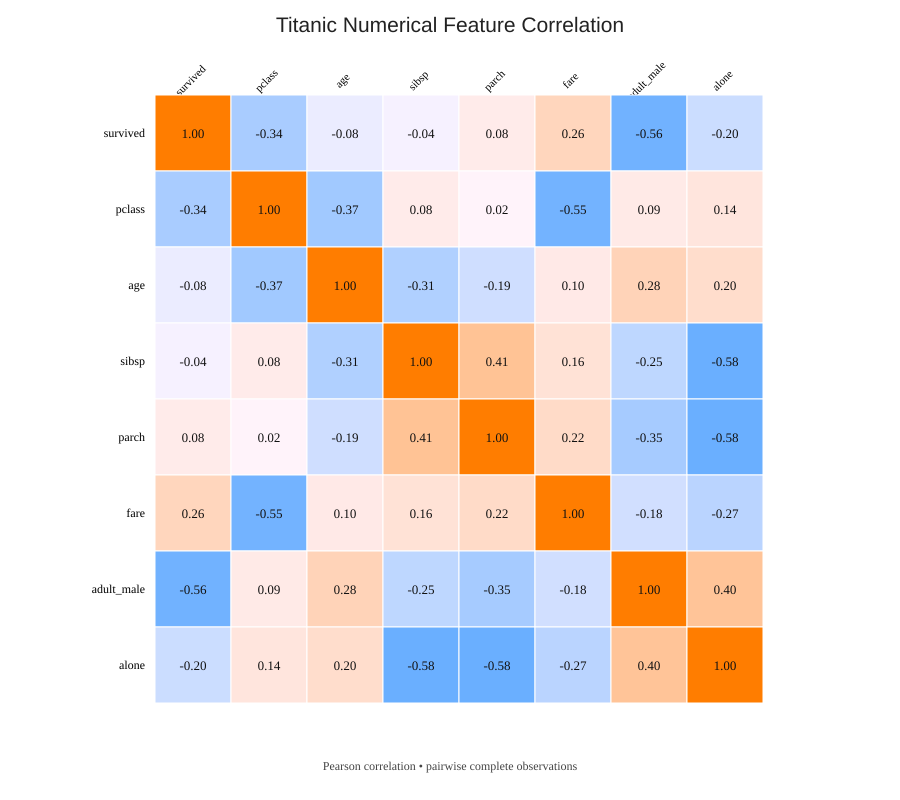

# Week 01 — Foundations, Data Cleaning & Exploratory Data Analysis

> **Engineering journal:** learning to inspect, clean, and understand data before building models on top of it.

This folder contains the practical work from the first week of my Data Science & Data Engineering Bootcamp. The focus is not simply to make a dataset look clean or produce attractive charts. It is to build a disciplined workflow: inspect the source, understand its limitations, make explainable transformations, and communicate what the data can — and cannot — tell us.

---

## Day 03 — Titanic Data Cleaning

**Notebook:** [`day3_titanic_cleaning.ipynb`](day3_titanic_cleaning.ipynb)

The Titanic dataset is a useful first exercise because it contains missing values, mixed feature types, and records that require deliberate quality checks.

### Cleaning decisions

- **Missingness in `deck`:** approximately 77% of the values are missing in the commonly used Seaborn Titanic dataset. For this initial workflow, I removed the column rather than attempting to infer most of its values.
- **Imputing `age`:** I filled missing ages with the median. The age distribution is not perfectly symmetric, and the median is less sensitive than the mean to unusually high or low observations.
- **Targeted row removal:** records missing `embarked` were removed specifically, instead of dropping every row with any missing value.
- **Duplicate handling:** exact duplicate rows were removed as a baseline quality check. In production, duplicate definitions should be based on the meaning and keys of the source data.

### Engineering takeaway

Cleaning is a sequence of decisions, not a mechanical checklist. Every transformation changes the data available for analysis, so the reason for each change should be explicit and reviewable.

---

## Day 04 — Exploratory Data Analysis & Data Visualization

**Notebook:** [`day4_titanic_visualization.ipynb`](day4_titanic_visualization.ipynb)

### The philosophy of visualization: see the shape before fitting the model

Before asking a machine-learning algorithm to learn from a dataset, I want to understand the dataset myself. Raw tables and summary statistics are essential, but they are not always intuitive. Human visual perception is particularly good at noticing clusters, skew, gaps, unusual observations, and relationships when they are presented spatially.

Visualization therefore acts as an early diagnostic layer. It helps form better questions, reveals assumptions that deserve testing, and can expose data-quality issues that a model might otherwise absorb silently. A chart does not replace statistical analysis; it gives the analysis context.

### 1. Passenger age distribution — histogram with KDE



The age histogram shows a clear concentration of passengers in young adulthood, with the strongest peak around **20–30 years**. The distribution then tapers toward older ages, forming a longer right tail. There is also a smaller group of very young passengers.

This shape matters for data preparation. A right-skewed distribution can pull the arithmetic mean upward, while the median is more resistant to extreme observations. That makes median imputation a reasonable baseline for missing ages in this exercise: it is less influenced by the older-age tail and represents the central observation more robustly.

The chart does not imply that every missing age should always be filled with one global median. In a more advanced pipeline, I would compare group-aware imputation (for example, by passenger class or other relevant features), validate the effect, and ensure that imputation is fitted only on the training data to avoid leakage.

### 2. Passenger class vs. fare — boxplot



The boxplot makes the economic divide between passenger classes visible:

- **First class (Pclass 1)** has the highest median fare and the widest spread. Its upper tail contains several extreme observations, including fares above 500.
- **Second class (Pclass 2)** is more concentrated, with a substantially lower median and a smaller range.
- **Third class (Pclass 3)** generally has the lowest fares, although it still contains high-fare outliers.

The outliers in first class are not automatically bad data. They may represent genuinely expensive tickets, shared bookings, or unusual fare arrangements. The correct engineering response is to investigate them and understand their origin before deciding whether to cap, transform, or exclude them. Removing every point beyond a boxplot whisker would risk discarding meaningful passenger records.

### 3. Numerical correlation heatmap



The heatmap summarizes pairwise Pearson correlations among the numeric columns. Two relationships stand out:

**Passenger class and fare: approximately -0.55.** This is a strong negative linear association. The class variable is numerically encoded as 1 for first class, 2 for second class, and 3 for third class. Therefore, a larger `pclass` value means a lower passenger class. The negative coefficient is consistent with fares generally decreasing as the class number increases.

**Passenger class and survival: approximately -0.33.** This negative association indicates that lower numerical class values — especially first class — are associated with higher survival rates. In other words, survival was not evenly distributed across passenger classes. This is an important exploratory signal, but correlation alone does not establish causation or account for other factors such as sex, age, and evacuation access.

Other patterns are also worth investigating. For example, `sibsp` and `parch` are positively associated because both describe family-related travel, while `adult_male` has a notable negative association with survival in this dataset. These relationships motivate more focused analysis rather than immediate conclusions.

> **Interpretation note:** Correlation measures linear association, not causation. The exact values can vary slightly with the dataset version, selected numeric columns, and missing-value handling. The notebook computes the matrix directly from the loaded Seaborn dataset.

### Day 04 engineering takeaways

1. Visual exploration should precede modeling because it reveals distribution shape, imbalance, unusual values, and relationships that deserve investigation.
2. The age distribution supports using the median as a robust baseline for missing-age imputation.
3. Fare distributions differ sharply by passenger class; outliers should be investigated, not automatically deleted.
4. The `pclass` encoding must be understood before interpreting the sign of a correlation coefficient.
5. A correlation heatmap is a map of associations and a source of hypotheses — not evidence of causal effects.

---

## Day 05 — Feature Engineering & Data Encoding

**Notebook:** [`day5_feature_engineering.ipynb`](day5_feature_engineering.ipynb)

### The philosophy of feature engineering: translate meaning into model-ready data

Many machine-learning algorithms operate on numerical representations. Real-world datasets, however, often describe useful information with text labels: a passenger's sex, a departure port, a product category, or a customer segment. Feature engineering is the disciplined process of turning those raw fields into representations that an algorithm can process without losing — or accidentally inventing — meaning.

Encoding is not merely a formatting step. The chosen representation affects how a model interprets a feature. A poor encoding can introduce a false order between categories, while a thoughtful encoding preserves the distinction between labels and quantities. This is why I treat feature transformations as part of the model design, not as incidental data cleanup.

### 1. Binary mapping — `sex`

The Titanic `sex` feature has exactly two categories in this dataset, so a compact binary mapping is appropriate:

- `male` → `1`
- `female` → `0`

This makes the feature numeric while keeping the mapping transparent and easy to audit. The values are category indicators, not measurements: `1` does not mean “more” sex than `0”, and the numerical gap has no domain meaning. The important engineering practice is to define the mapping explicitly and decide how unexpected or missing labels should be handled in a production pipeline.

### 2. One-hot encoding — `embarked`

The `embarked` feature identifies nominal departure ports. These categories have no natural ranking. Assigning arbitrary ordinal values such as 0, 1, and 2 would risk telling a model that one port is “greater than” another, or that the distance between two port codes is meaningful.

Instead, I used `pd.get_dummies` with `prefix='embarked'` to create separate indicator columns for the categories. Each indicator records whether a passenger belongs to that category. This representation allows a model to learn category-specific effects without inventing an order between ports.

### 3. The dummy-variable trap and `drop_first=True`

If every one-hot column is retained alongside an intercept in a linear model, the dummy columns sum to one for each observation. One column can therefore be reconstructed exactly from the others and the intercept. This creates perfect multicollinearity — the classic **dummy-variable trap** — and makes the design matrix redundant.

Using `drop_first=True` removes one category column and makes it the reference category. When all retained indicators are zero, the observation belongs to that omitted category. The model can estimate the other categories relative to this baseline without including a perfectly redundant set of dummy variables.

This is a modeling convention, not a universal requirement for every algorithm: tree-based models, models without an intercept, and regularized or specialized estimators can have different considerations. For the conventional linear-model setting, dropping one dummy is a clear and widely used approach.

### 4. Concatenation and sanity checks

After creating the encoded `embarked` columns, I removed the original text column and combined the encoded features with the remaining DataFrame using `pd.concat(..., axis=1)`. The `axis=1` argument means the objects are joined side by side as columns, with their row indexes aligned.

Finally, I inspected the encoded sample, resulting shape, column names, and data types. These checks are small but important: they help catch accidental index misalignment, unexpected output columns, or categorical fields that were not transformed as intended.

### Day 05 engineering takeaways

1. Machine-learning models need numerical representations, but encoding must preserve the semantics of the original feature.
2. Direct binary mapping is concise and interpretable for a truly binary category when the mapping is documented.
3. One-hot encoding is appropriate for nominal categories such as embarkation ports because it avoids imposing a false ordinal relationship.
4. `drop_first=True` selects a reference category and prevents the exact dummy-variable dependency in a typical model with an intercept.
5. After every transformation, inspect the schema and sample rows — never assume that a successful function call guarantees a correct dataset.

> **Production perspective:** In a real training workflow, category handling must be consistent between training and inference. Fit encoders using training data only and apply the learned transformation to validation, test, and production data. Scikit-learn's `OneHotEncoder` within a `ColumnTransformer` is a strong next step for building leakage-safe, reproducible preprocessing pipelines.

---

## Week 01 Structure

```text
week-01/
├── images/
│   ├── age_distribution.svg
│   ├── fare_by_class_boxplot.svg
│   └── correlation_heatmap.svg
├── day3_titanic_cleaning.ipynb
├── day4_titanic_visualization.ipynb
├── day5_feature_engineering.ipynb
└── README.md
```

The notebook also saves high-resolution PNG versions of the three plots into the local `images/` directory when executed.

---

## Tools Used

- **Python** — analysis and scripting
- **Pandas** — data inspection and transformation
- **Seaborn** — statistical visualization and the Titanic sample dataset
- **Matplotlib** — figure layout and export
- **Jupyter Notebook** — interactive, reproducible analysis
- **Git & GitHub** — version control and public documentation

---

*Week 01 is a foundation: understand the data, preserve its integrity, and make every analytical decision explainable.*
